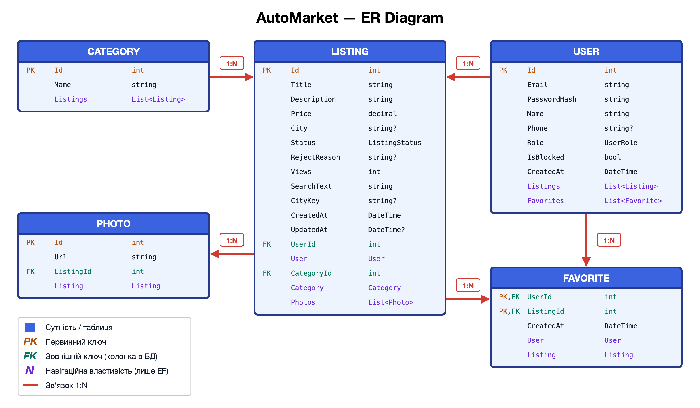
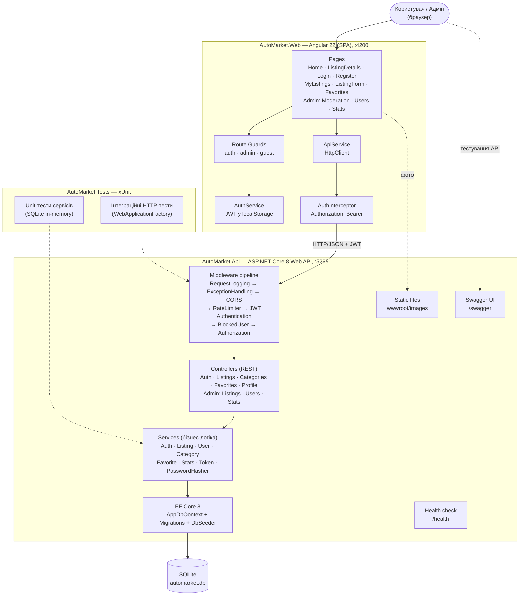
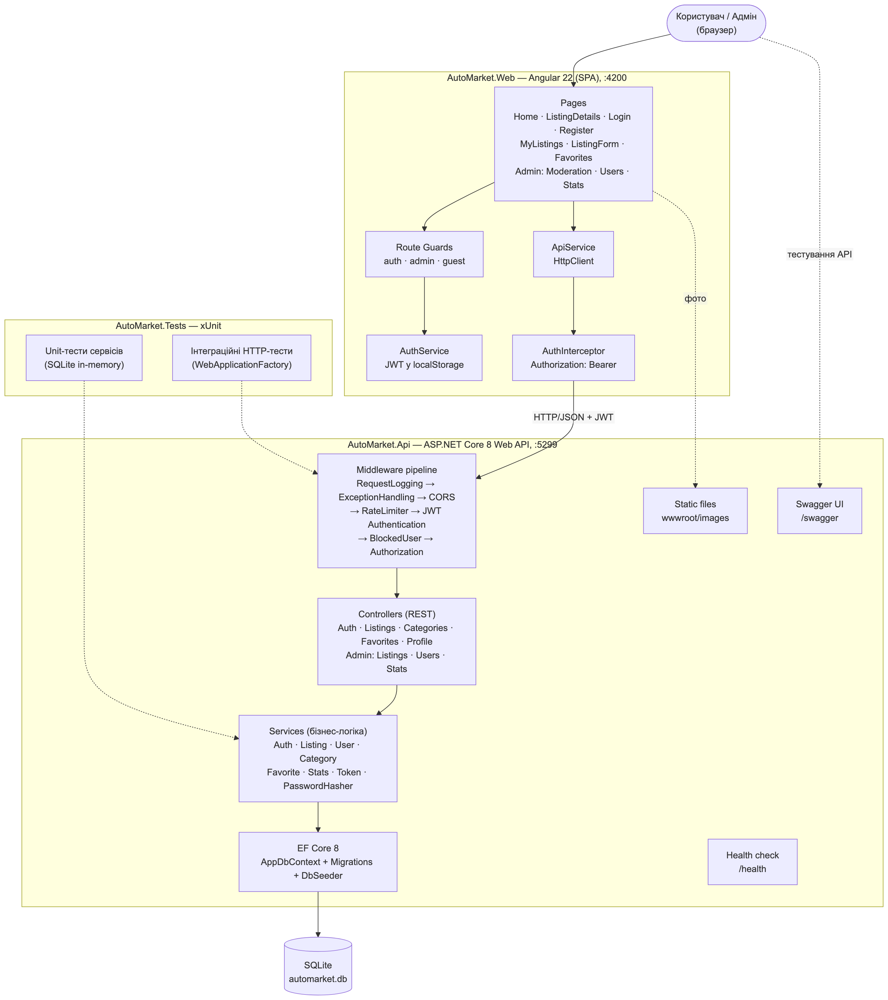

# Діаграми AutoMarket

Архітектура — текст Mermaid у `diagrams/architecture.mmd` (Rider і GitHub малюють його прямо в Markdown), ER-діаграма — скрипт `diagrams/er.py`. Готові картинки для звіту/презентації: `diagrams/*.png` і `diagrams/*.svg`.

## ER-діаграма бази даних

5 таблиць: користувачі, категорії, оголошення, фото, обране (зв'язок багато-до-багатьох між користувачами та оголошеннями).
Показано колонки з типами, первинні (PK) і зовнішні (FK) ключі, навігаційні властивості EF Core та зв'язки 1:N.

Картинка генерується скриптом: `python3 docs/diagrams/er.py` → `er.svg`.

## Архітектура

Клієнт-серверна архітектура: Angular SPA → REST API (ASP.NET Core) → EF Core → SQLite. API розділено на шари: middleware → контролери → сервіси → доступ до даних.

